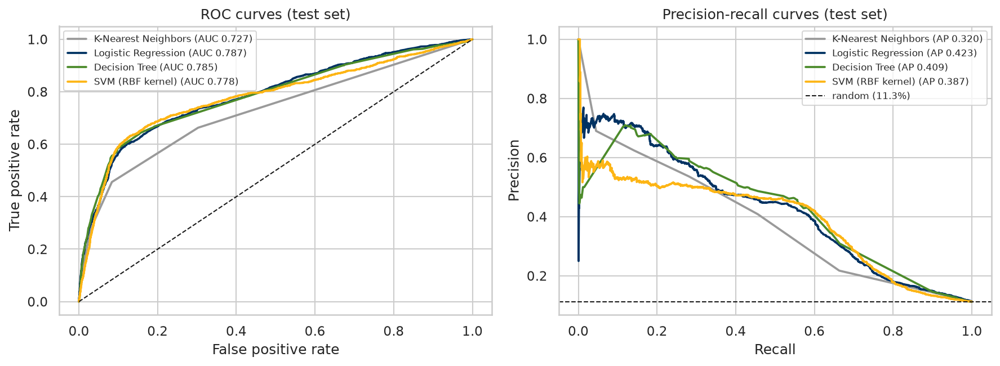
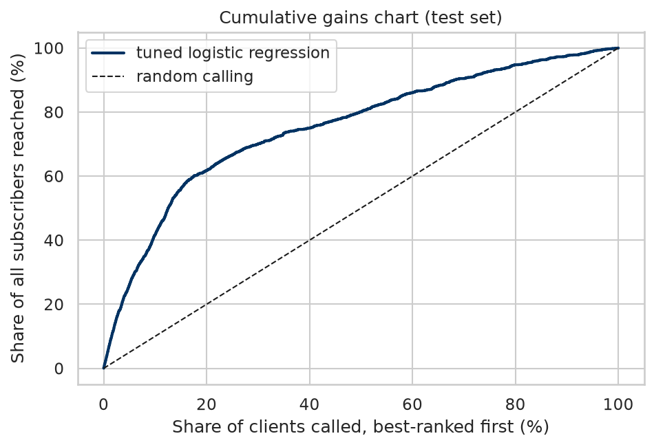
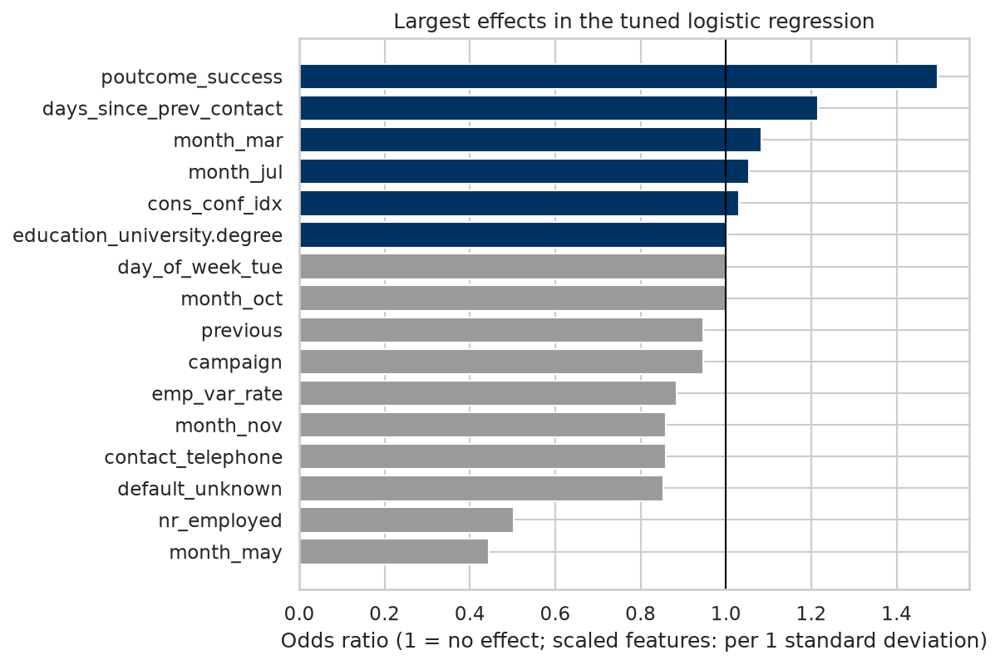
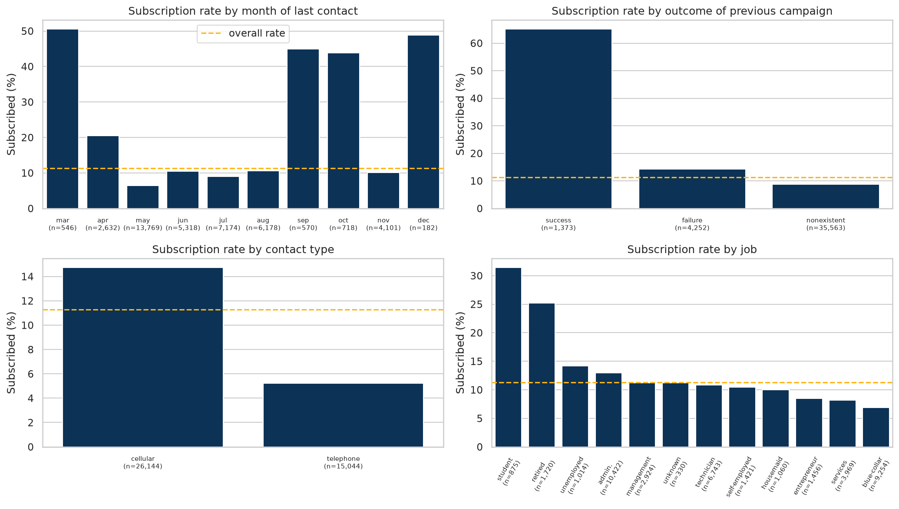

# Comparing Classifiers: Which Bank Clients Will Subscribe to a Term Deposit?

**UC Berkeley ML/AI Professional Certificate: Practical Application III**

This project compares four classifiers (**K-Nearest Neighbors, Logistic Regression, Decision Tree, Support Vector Machine**) on real telemarketing data from a Portuguese bank, to find out which clients are worth calling to offer a term deposit.

📓 **Notebook:** [`bank_marketing_classifier_comparison.ipynb`](bank_marketing_classifier_comparison.ipynb)

---

## The Question

A bank phones clients to sell a term deposit. Every call costs time, and about 89% of the calls end in "no". **Can we predict, before dialing, who is likely to say yes, so the bank can spend its calls where they count?**

## The Data

- **Source:** UCI Machine Learning Repository, [Bank Marketing](https://archive.ics.uci.edu/dataset/222/bank+marketing) (Moro, Cortez & Rita, 2014).
- **What it is:** 41,188 phone contacts from **17 marketing campaigns** run by a Portuguese bank between **May 2008 and November 2010**, with 20 features and the outcome (`y`: did the client subscribe?).
- **Features:** client details, details of the last contact, campaign history, and five economic indicators.
- **Class imbalance:** only **11.3%** of contacts subscribed, so accuracy is a misleading metric. The notebook selects models on **F1 for the "yes" class**, and judges ranking with ROC AUC and precision-recall AUC.
- **Call duration is excluded** from the realistic models. It is only known after the call ends, so it cannot be used to decide whom to call. It appears only as a labelled benchmark.

## Approach

| Step | What I did |
|---|---|
| Understand the data | Missing values (coded as `"unknown"`), duplicates, distributions, subscription rate by group, correlations |
| Inferential statistics | Chi-square tests with Cramér's V, Mann-Whitney U tests with effect sizes, Wilson confidence interval, Bonferroni-adjusted threshold |
| Prepare features | One-hot encoding and scaling inside `Pipeline`s (no leakage); `pdays` = 999 turned into a "previously contacted" flag |
| Baseline | Always predict "no": 88.7% accuracy, finds **no** subscribers |
| Compare models | All four with default settings (fit time, train and test accuracy, plus precision, recall, F1, ROC AUC, PR AUC) |
| Improve | 5-fold cross-validated **grid search** for every model, scored on F1; feature-set comparison; `class_weight` |
| Interpret | Logistic-regression odds ratios, permutation importance, decision-tree structure |
| Decide | ROC and precision-recall curves, F1-optimal and **cost-based decision threshold** (with a sensitivity table), lift and gains chart |
| Robustness | Train on the earliest 70% of contacts, test on the latest 30% |

## Key Results

Test set of 13,593 clients (random stratified split, `test_size=0.33`, `random_state=10`):

| Model | Default test accuracy (client-only features) | Tuned test F1 (extended features) | Tuned ROC AUC |
|---|---|---|---|
| Baseline (always "no") | 0.887 | 0.000 | 0.500 |
| K-Nearest Neighbors | 0.878 | 0.369 | 0.727 |
| Logistic Regression | 0.887 | 0.450 | **0.787** |
| Decision Tree | 0.862 | 0.449 | 0.785 |
| SVM (RBF kernel) | 0.887 | **0.481** | 0.778 |

- **Accuracy hides everything.** With client details alone, nothing beats the 88.7% baseline, and default logistic regression and the SVM find almost no subscribers.
- **Tuning and richer features lift F1 from near 0 to about 0.45 to 0.48.** Logistic regression, the decision tree and the SVM are tied within noise. KNN is clearly worst.
- **Chosen model: tuned logistic regression.** It ranks as well as the alternatives, fits in about 5 seconds (the SVM search takes about 270), and its few surviving coefficients can be explained.



### What the model is worth to the bank

At the chosen cutoff the model **finds about 58% of the subscribers by calling about 16% of the clients**. Calling the best-ranked clients first beats calling at random:



| Clients called (top %) | Share of all subscribers reached | Lift vs random |
|---|---|---|
| 10% | 41.7% | 4.2x |
| 20% | 61.8% | 3.1x |
| 50% | 80.1% | 1.6x |

## Findings for the Business

- **Past customers are the best prospects**: clients who said yes to an earlier campaign subscribed **65%** of the time (versus 9% for clients never contacted before).
- **Mobile beats landline**: 14.7% versus 5.2%.
- **Students (31%) and retirees (25%) respond best**; blue-collar and service workers respond least (7% to 8%).
- **Timing matters**: a third of the calls were made in May, the weakest month (6.4% success), while March, September, October and December reached 44% to 51% on far fewer calls. Worth a controlled test.
- **Home loan and personal loan status do not help** predict a "yes".

The tuned logistic regression keeps only 17 of 53 coefficients. Its largest effects (odds ratio above 1 = more likely to subscribe) are a previous campaign success, and below 1 are May as the contact month and the economic indicator `nr_employed`:





### An important caution

The model that uses the **economic indicators** (interest rate, employment) scores well on a random split (ROC AUC 0.79) but **fails on later data** when trained on early contacts (ROC AUC 0.40, worse than a coin flip). The version **without** them holds up (ROC AUC 0.75 on both). The economy changed a lot between 2008 and 2010, so these indicators mostly tell the model *when* a call happened. **For real use, build the call-ranking model from client, contact and campaign-history features, and retrain it regularly.**

## Recommendations and Next Steps

1. Put clients with a successful previous campaign at the top of the call list, and prefer mobile numbers.
2. Use the model to **rank the list and stop earlier**. Set the cutoff from the bank's real cost of a call and value of a deposit (the notebook includes a table for several cost ratios).
3. **A/B test** a ranked list against the current list, measuring subscriptions per call.
4. Next modeling steps: ensembles (random forest, gradient boosting), time-aware validation, calibration, richer features.

Full detail, including the statistical tests, interpretation and next steps, is in the notebook.

## Repository Structure

```
├── bank_marketing_classifier_comparison.ipynb   # the full analysis
├── data/
│   ├── bank-additional-full.csv                 # dataset (UCI Bank Marketing)
│   └── bank-additional-names.txt                # data dictionary from UCI
├── images/                                      # figures used in this README
├── pyproject.toml, uv.lock, .python-version     # environment
└── README.md
```

## How to Run

```bash
uv sync
uv run jupyter lab bank_marketing_classifier_comparison.ipynb
```

Requires Python 3.12+. The full notebook takes about 6 minutes to run, mostly the SVM grid search.

## Reference

Moro, S., Cortez, P., & Rita, P. (2014). A data-driven approach to predict the success of bank telemarketing. *Decision Support Systems*, 62, 22-31. https://doi.org/10.1016/j.dss.2014.03.001
